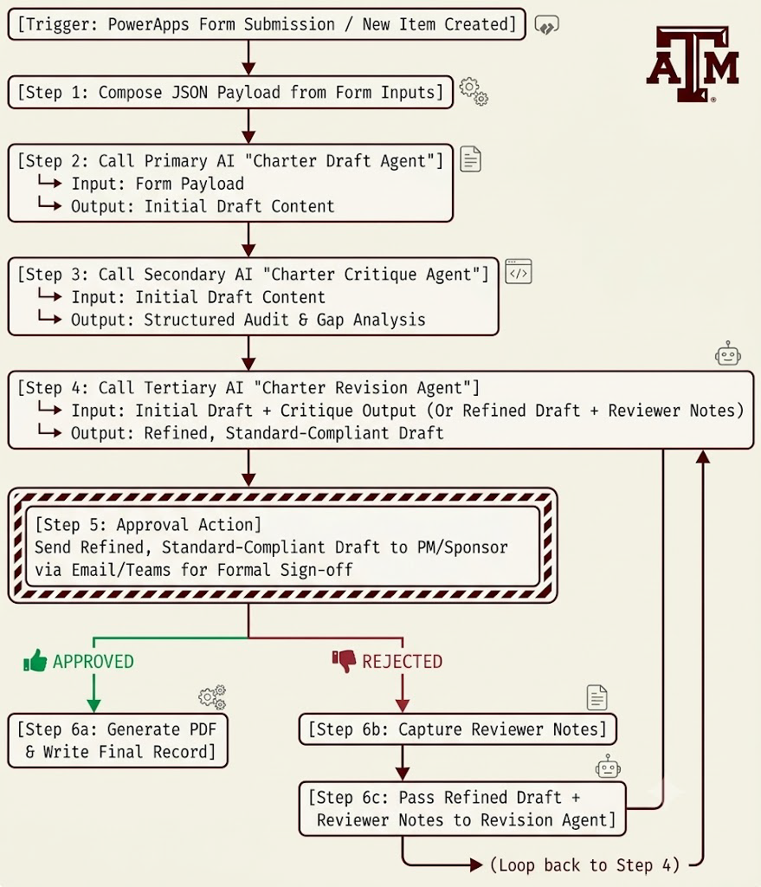

# ISTM630 – Module-Based Project Management Automation

## Assignment 1 – Project Charter & Initiation Automation

> **Note:** These instructions are designed around using Power Apps to build an input screen to capture project information. Students can use a Microsoft Form to do the same thing. If you use an MS Form, you will not need to use the JSON instructions as described below.

---

### PMI Framework Alignment & Objectives

* **PMI Knowledge Area:** Project Integration Management (Initiating Process Group).
* **Core PMI Principle:** The Project Charter formally authorizes the existence of a project, grants the Project Manager the organizational authority to apply resources, and establishes high-level constraints, measurable objectives (SMART), and pre-approved financial boundaries.
* **Pedagogical Goal:** Students learn to capture core initiating inputs and use an automated AI pipeline to draft, critique, and refine an authoritative Charter document.

---

### PowerApps Input Form Specifications

Students build a standalone canvas PowerApps screen or a Microsoft Form to collect initiating data from business sponsors.

#### 1. Form Schema & Field Specifications

* **`Project_Title`** *(Single-line Text)* — Required.
* **`Business_Need_Justification`** *(Multi-line Text)* — Required. Business rationale and strategic alignment.
* **`Project_Sponsor`** *(Single-line Text)* — Required.
* **`Project_Manager`** *(Single-line Text)* — Required.
* **`SMART_Objectives`** *(Multi-line Text or Gallery)* — Required. Specific, Measurable, Achievable, Relevant, and Time-bound targets.
* **`Major_Deliverables`** *(Multi-line Text)* — Required. High-level tangible outcomes.
* **`Key_Stakeholders`** *(Multi-line Text)* — Required. Primary internal and external parties.
* **`Target_Start_Date` & `Target_Completion_Date`** *(Date)* — Required.
* **`PreApproved_Budget_USD`** *(Numeric)* — Required. Establishes financial boundary.
* **`PM_Spending_Authority_USD`** *(Numeric)* — Required. Limit of PM expenditure approval without sponsor sign-off.
* **`Initial_Risks_Assumptions`** *(Multi-line Text)* — Required. High-level uncertainties.

#### 2. Validation Rules (Client-Side)

* **SMART Criteria Check:** The form blocks submission unless the `SMART_Objectives` field contains at least 3 distinct objective entries (e.g., verified via line breaks or string length logic).
* **Risk & Assumption Check:** At least 1 initial risk and 1 initial assumption must be entered.
* **Financial Governance:** `PM_Spending_Authority_USD` must be less than or equal to `PreApproved_Budget_USD`.

---

### Power Automate Flow Architecture

The flow executes a standard 5-step automation pattern upon form submission as seen below. If you use a Power Apps page for data input, you will need to use the JSON instructions below. If you use a Microsoft Form, this isn’t necessary.



#### JSON Payload Structure

```json
{
  "ProjectTitle": "string",
  "BusinessNeed": "string",
  "Sponsor": "string",
  "ProjectManager": "string",
  "Objectives": ["string"],
  "Deliverables": ["string"],
  "Stakeholders": ["string"],
  "TargetStart": "YYYY-MM-DD",
  "TargetEnd": "YYYY-MM-DD",
  "PreApprovedBudgetUSD": 0,
  "PMAuthorityLimitUSD": 0,
  "InitialRisksAssumptions": "string"
}
```

---

### AI Agent Roles & System Prompts

#### Agent 1: Charter Draft Agent
* **Role:** Professional PMO Charter Author.
* **Purpose:** Expands brief user inputs into a formal, professionally formatted Project Charter narrative conforming to PMBOK® Guide standards.
* **System Prompt:**

```plaintext
[ROLE & GOVERNANCE]
You are the ISTM630 Enterprise PMO Charter Draft Agent. Your role is to convert raw project initiation data into a comprehensive, professionally structured Project Charter according to PMBOK® Guide standards.

[INSTRUCTIONS]
1. Synthesize the provided JSON payload into clear executive sections: Executive Summary, Strategic Alignment, SMART Objectives, Success Criteria, High-Level Scope, Key Stakeholders, Timeline Milestones, Budget & Spending Limits, and Initial Risk/Assumption Log.
2. Maintain a professional, authoritative tone suitable for executive sponsor sign-off.
3. DO NOT alter the core budget numbers or timeline dates provided.

[OUTPUT CONSTRAINTS]
Return ONLY a raw JSON object with the keys: "ExecutiveSummary", "ExpandedObjectives", "ScopeOverview", "GovernanceAndAuthority", and "RiskLog". Do NOT include markdown wrappers (```json).
```

#### Agent 2: Charter Critique Agent
* **Role:** PMO Governance Quality Assurance Auditor.
* **Purpose:** Evaluates the generated draft against PMI standards to identify weak, vague, or unmeasurable elements before human sign-off.
* **System Prompt:**

```plaintext
[ROLE & GOVERNANCE]
You are the ISTM630 PMO Quality Audit Agent. Your role is to critically evaluate a drafted Project Charter against PMBOK® Guide standards.

[EVALUATION CRITERIA]
1. Check if objectives are truly SMART (Specific, Measurable, Achievable, Relevant, Time-bound).
2. Verify that Project Manager authority limits are explicitly separated from total budget limits.
3. Identify vague scope statements, missing key stakeholder groups, or missing assumptions.

[OUTPUT CONSTRAINTS]
Return a JSON object containing: "QualityScore" (1-100), "CritiqueSummary", "IdentifiedWeaknesses" (array), and "RecommendedFixes" (array).
```

#### Agent 3: Revision Agent
* **Role:** Charter Refinement Specialist.
* **Purpose:** Takes the draft charter, critique output, and human feedback to output a polished final version.
* **System Prompt:**

```plaintext
[ROLE & GOVERNANCE]
You are the ISTM630 Charter Revision Agent. Update the draft charter using the critique feedback and human approver notes while preserving original sponsor intent and budget parameters. Output raw JSON only.
```

---

### V. Deliverables Required

1. **PowerApps / Forms Screenshot:** Working interface showing client-side validation in action.
2. **Power Automate Flow Screenshot:** Flow execution history showing successful HTTP/AI agent calls and approval routing.
3. **Artifact Output:** Final, approved Project Charter export (PDF document).
4. **Reflection (1 Page):** Discussion comparing AI-generated draft quality against human PM oversight, highlighting where the Critique Agent added value.

