# Project Charter & Initiation Automation

## Microsoft Form

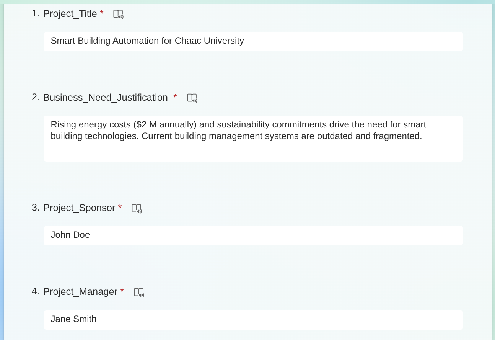

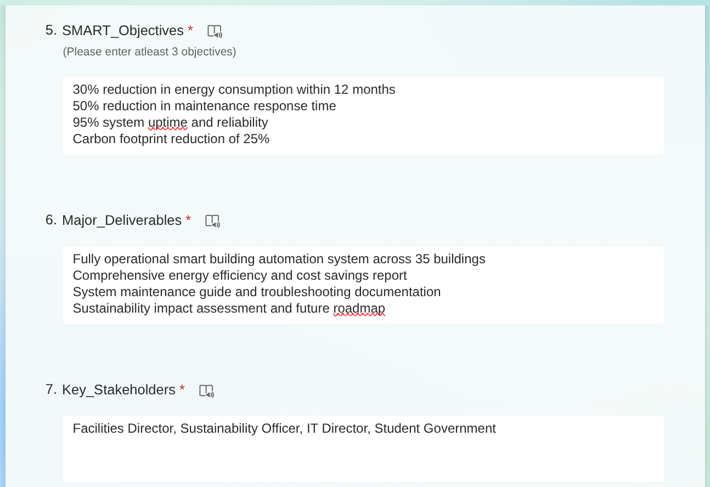

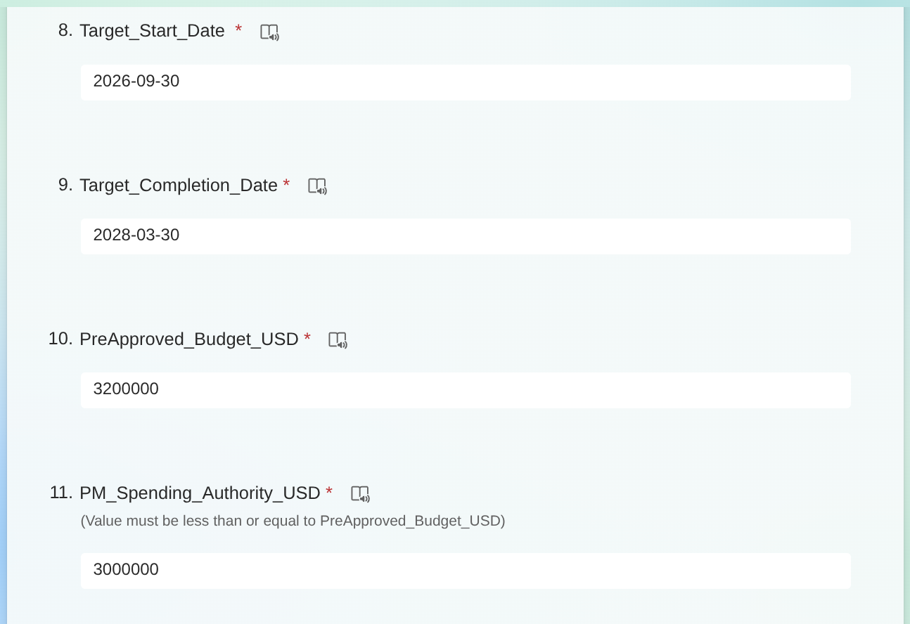

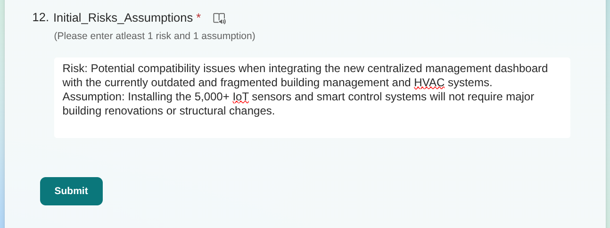

---

## PowerAutomate

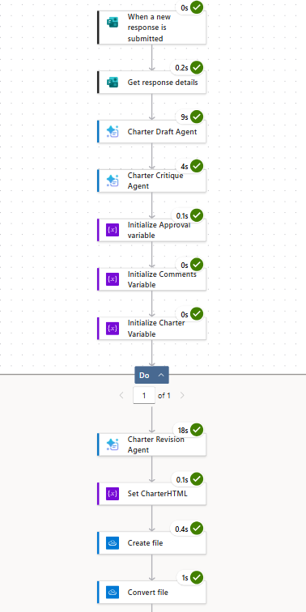

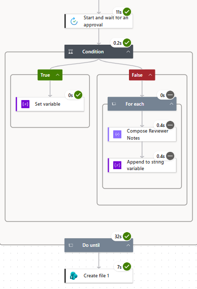

---

## PDF Output

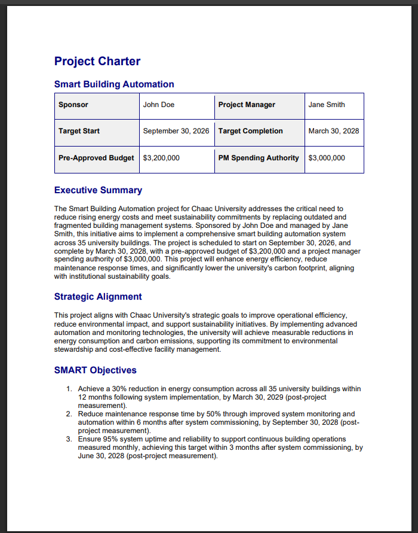

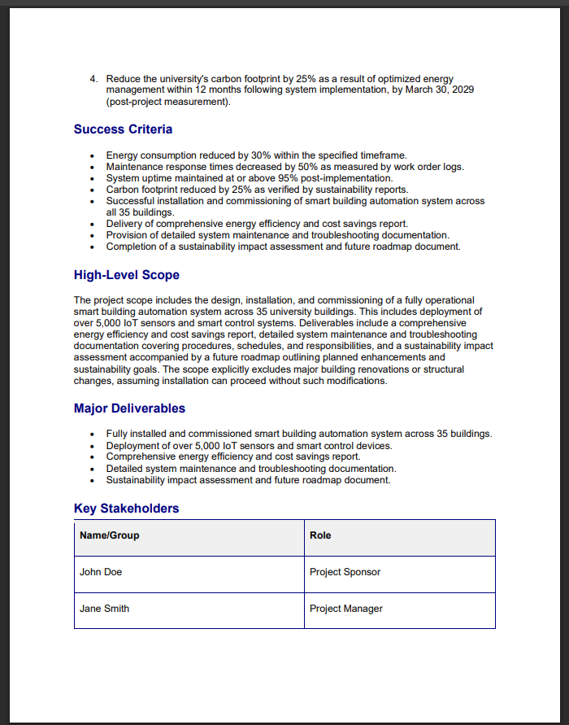

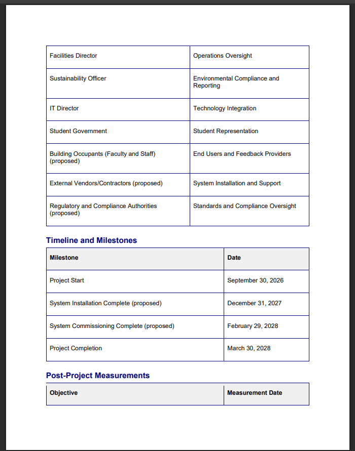

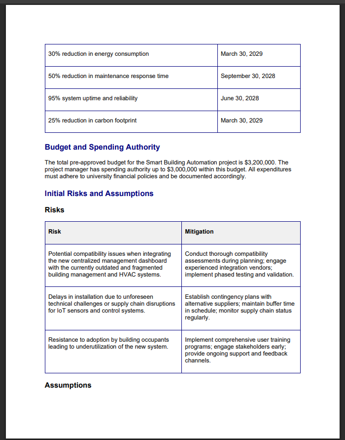

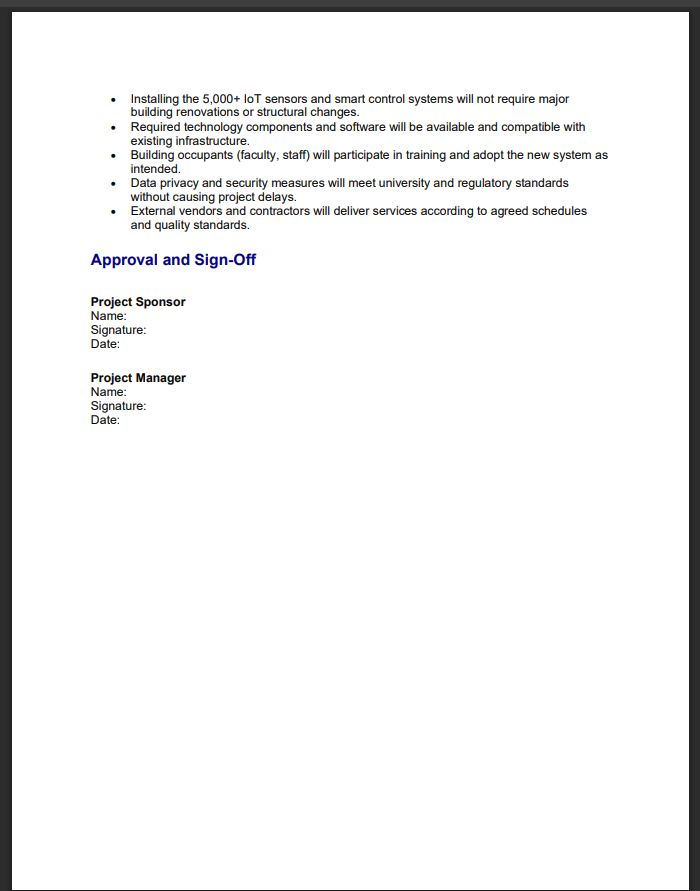

---

## Reflection

Through this project we understood how PM tasks like Project Initiation can be accelerated using a multi-agent framework within PowerAutomate. In our evaluation of the data flow, from its initiation in Microsoft Forms to the final generated output of the Project Charter, we were able to find clear distinctions between the initial drafts generated by the Charter Draft Agent and the final output after taking feedback from the Charter Critique Agent. Additionally, the most important role in this flow is of the human Project Manager.

The Draft Agent through the initial microsoft form was able to capture the baseline information like the project dates, the budget and high level targets. It was able to professionally format that information while following PMBOK standards into sections like SMART objectives, Strategic Alignment or Success Criteria. But the output generated by this agent was superficial and lacked critical evaluation of the inputs as the standard generative prompt will essentially reiterate the submitted bullet points in formal language and not critically break down the information.

As we could verify from the downstream improvements in the final charter, we observed that the critique agent found that for the 30% reduction in energy consumption 12 months post commissioning meant that it fell under post project goals with a date of March 30, 2029. The critique agent was also able to point out missing stakeholders like Building Occupants, External Vendors/Contractors and Regulatory Authorities. It was also able to add additional risks and assumptions on top of the initial entries that were submitted through the form.

Finally, the human Project Manager approving the Project Charter is the most critical for this flow. Once he receives email for approval, he is authorized to accept or reject the draft. If rejected, he can comment points in the approval window which provides him a way to improve the existing draft by looping his prompt back into the revision agent. This reaffirms that the project charter just consists of suggested milestones and risk mitigation plans, until verified by the manager on the basis of real world procurement, schedules and availability. This agent workflow hence eliminates the time it takes to draft the charter by inherently enforcing the PMBOK guidelines and at the same time enforcing Human-in-the-loop approval.

---

## Form Inputs

* **Project_Title:** Smart Building Automation for Chaac University.
* **Business_Need_Justification:** Rising energy costs ($2M annually) and sustainability commitments drive the need for smart building technologies. Current building management systems are outdated and fragmented.
* **Project_Sponsor:** John Doe
* **Project_Manager:** Jane Smith
* **SMART_Objectives:**
  * 30% reduction in energy consumption within 12 months
  * 50% reduction in maintenance response time
  * 95% system uptime and reliability
  * Carbon footprint reduction of 25%
* **Major_Deliverables:**
  * Fully operational smart building automation system across 35 buildings
  * Comprehensive energy efficiency and cost savings report
  * System maintenance guide and troubleshooting documentation
  * Sustainability impact assessment and future roadmap
* **Key_Stakeholders:** Facilities Director, Sustainability Officer, IT Director, Student Government.
* **Target_Start_Date:** 2026-09-30
* **Target_Completion_Date:** 2028-03-30
* **PreApproved_Budget_USD:** 3,200,000
* **PM_Spending_Authority_USD:** 3,000,000
* **Initial_Risks_Assumptions:**
  * **Risk:** Potential compatibility issues when integrating the new centralized management dashboard with the currently outdated and fragmented building management and HVAC systems.
  * **Assumption:** Installing the 5,000+ IoT sensors and smart control systems will not require major building renovations or structural changes.

